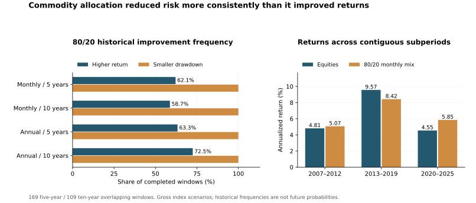

# Commodity allocation follow-up exploration

[Chinese version](exploration-20261108.zh-CN.md)

The strongest finding is risk reduction, while return improvement depends on the holding window. A monthly 80/20 equity/commodity mix improved both return and daily maximum drawdown in 105 of 169 five-year windows and 64 of 109 ten-year windows. Its small whole-sample return advantage allowed only about 8.2 basis points of extra annual portfolio wealth drag. Actual sector ETFs are usable research subjects, but they do not implement the broad Nanhua composite. The macro exercise remains a publication-timing reconstruction, with no verified historical-vintage timing result.

The baseline remains December 29, 2006–December 31, 2025, CNY nominal CSI 300 total return and the published Nanhua commodity index. First-round inputs and results are unchanged. [Validation and reproduction](exploration-validation-20261108.md) and the [reviewed aggregate](exploration-summary-20261108.json) retain all sixteen combinations of weights, rebalance rules and holding horizons.

## Allocation robustness

Every window starts afresh at its stated weights. Maximum drawdown uses daily observations, not only monthly endpoints. The counts below are overlapping historical windows, not estimates of future success probabilities. No costs or collateral cash income are included.

| Rebalance | Years | Completed windows | Higher return | Smaller drawdown | Both |
| --- | --- | --- | --- | --- | --- |
| monthly | 5 | 169 | 105 (62.13%) | 169 (100.00%) | 105 (62.13%) |
| monthly | 10 | 109 | 64 (58.72%) | 109 (100.00%) | 64 (58.72%) |
| annual | 5 | 169 | 107 (63.31%) | 169 (100.00%) | 107 (63.31%) |
| annual | 10 | 109 | 79 (72.48%) | 109 (100.00%) | 79 (72.48%) |

Returns failed to improve in 64 five-year and 45 ten-year monthly windows. The largest five-year annualized return shortfall occurred from June 30, 2010 to June 30, 2015: the mix returned 10.25% versus equities' 13.97%, although maximum drawdown improved from 38.55% to 35.71%. Lower losses did not guarantee higher terminal wealth.

The following contiguous periods preserve real time; crises were not deleted and the surviving returns spliced together. Annual entry cohorts with at least five years to the fixed endpoint are also retained in the aggregate.

| Exact period | Equity CAGR | 80/20 monthly CAGR | Equity drawdown | Mix drawdown |
| --- | --- | --- | --- | --- |
| 2006-12-29 → 2012-12-31 | 4.81% | 5.07% | -72.04% | -65.91% |
| 2012-12-31 → 2019-12-31 | 9.57% | 8.42% | -46.06% | -40.18% |
| 2019-12-31 → 2025-12-31 | 4.55% | 5.85% | -41.56% | -29.30% |

## Implementation and costs

The gross whole-sample mix CAGR was 6.54%, versus equities' 6.45%. The geometric extra annual total-portfolio drag budget was **8.22 bp**, approximately 0.082% per year. This is an additional whole-portfolio drag, not a quoted fund fee or a cost applied only to the 20% commodity sleeve.

In a separate idealized rebalance-cost account, annualized two-sided turnover was about 20.79% of wealth. Fees apply to both buy and sell notional and are funded from the account before targets are assigned. Initial purchases, final liquidation and underlying futures contract rolls are excluded. The fee that exhausted the gross advantage was **39.54 bp per unit of two-sided traded notional**. This is not an exchange-fee calibration or a claim of feasible execution.

| Fee per traded notional, bp | Mix CAGR | Maximum drawdown |
| --- | --- | --- |
| 0 | 6.54% | -65.91% |
| 10 | 6.52% | -65.92% |
| 50 | 6.43% | -65.98% |
| 100 | 6.32% | -66.06% |

A separate cash-rate sensitivity uses the shorter January 31, 2007–December 31, 2025 sample, because an earlier cash quote was unavailable. The stock comparator returned 5.61% CAGR in that matched sample. With 0%, 50% and 100% of a lagged Shibor overnight rate as hypothetical commodity collateral income, the monthly 80/20 mix returned 5.89%, 6.11% and 6.34%. Shibor is an interbank rate proxy, not a promised investable yield. This sensitivity assumes the published index excludes collateral interest; full historical confirmation remains unresolved. If cash is already embedded, adding it would double count. Cash was never added to fund NAV. None of this reconstructs actual contract quantities, margin calls or slippage.

## Actual sector ETFs

The return proxies below end December 31, 2025, but begin on different listing histories. Market return uses close multiplied by the provider adjustment factor. Adjusted NAV is a retrospective valuation proxy, with internal fund expenses already embedded; it is not an executable price or an announcement-time signal. Investor trading costs are excluded. No manager fee was subtracted again.

| Product | Observed market start | Market CAGR proxy | Adjusted-NAV CAGR proxy | 2025 NAV return |
| --- | --- | --- | --- | --- |
| 159980.SZ | 2019-12-24 | 11.87% | 11.93% | 22.28% |
| 159981.SZ | 2020-01-17 | 4.29% | 4.04% | -11.84% |
| 159985.SZ | 2019-12-05 | 11.88% | 11.57% | 4.18% |

All three 2025 NAV returns match their original annual reports at disclosed precision. The benchmarks are respectively the SHFE nonferrous futures price index, Yisheng ZCE energy/chemical index A and DCE soybean-meal futures price index. None is NHCI. The report therefore does not label their differences versus NHCI as tracking error. The aggregate includes separately dated illustrative 80/20 stock/product comparisons; they change the exposure and do not validate a broad-commodity allocation. No complete, timestamped, survivorship-controlled CTA net-value universe was established, so CTA returns were not estimated from selected surviving products.

## Macro environments

Thresholds were fixed at manufacturing PMI 50 and PPI year-on-year 0. Official manufacturing events were separated from Caixin and non-manufacturing events. Reconstructed release events become usable on the following local calendar day, then are matched to the actual prior month-end decision session for the next month's returns. The table is a **diagnostic reconstruction using values retrieved now**, not verified point-in-time history.

| Reconstructed environment | Months | Mean next-month equity return | Commodity | 80/20 mix |
| --- | --- | --- | --- | --- |
| PMI ≥50 / PPI ≥0 | 90 | -0.11% | 0.65% | 0.04% |
| PMI <50 / PPI ≥0 | 17 | -0.10% | -1.93% | -0.46% |
| PMI ≥50 / PPI <0 | 74 | 1.01% | -0.06% | 0.79% |
| PMI <50 / PPI <0 | 46 | 2.38% | 1.72% | 2.25% |

There were 227 classified months and one unavailable month. Event dates establish a timing hypothesis, not the historical vintage of the value. Strict historical admission produced **zero eligible months**. The existing owner archive was first observed in August 2026 and has no PPI series in the selected snapshot; it cannot authenticate the 2007–2025 sample. One- and two-month lagged revised-snapshot sensitivities are retained separately. Neither the conditional returns nor the small regime groups demonstrate causality or timing effectiveness, and noncontiguous regime observations were not compounded into a fake equity curve.

## Source evidence and remaining limits

The five precise gap requests remained empty: four commodity series on January 26–27, 2006, and CSI All Share total return on August 2, 2011. Original gaps and the shorter baseline are preserved. Additional original Nanhua materials were recovered: a 2012 investment handbook describes an eight-day roll; the 2022 rulebook, like the retained 2025 one, contains both an eight-session introduction and five-session detailed rules. This narrows the evidence trail but does not identify an authoritative effective rule for every historical date. A 2024 daily report adds another original point check; it is not a replacement for year-end annual-return reconciliation.

The next useful evidence is an authoritative historical roll/version ledger, missing-session resolution, actual cash/contract execution receipts and an authentic macro-vintage archive. None of the four explorations supports selecting a historically optimal weight or trading a macro signal.

Sources: [Nanhua 2012 handbook](https://www.nanhua.net/cmsbigfile/2013/11/6b9d6e8e-567a-41f0-9c7a-6a353cf18884/NHCI_rulebook.pdf), [2022 rules](https://www.nanhua.net/cmsbigfile/2022/11/76b2ec32-618d-44b7-89a4-97d22ed2f3c1/南华商品指数编制细则（2022）发布公告.pdf), [nonferrous ETF annual report](https://www.dcfund.com.cn/plat_files/upload/ann_upload/20260330/202603301774866009812.pdf), [energy ETF annual report](https://static.cninfo.com.cn/finalpage/2026-03-30/1225041054.PDF), [soymeal ETF annual report](https://www.chinaamc.com/upload/resources/file/2026/03/31/2b893ee6439042a49a19d864b2107cf3.pdf), [official PMI release](https://www.stats.gov.cn/sj/zxfb/202512/t20251231_1962218.html).
