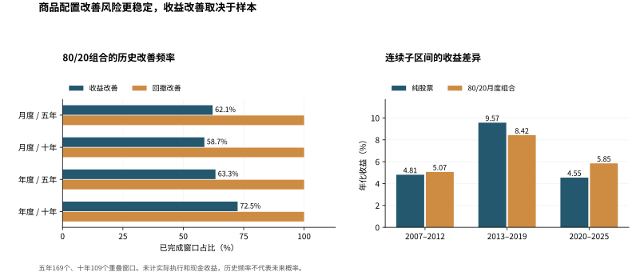

# 商品配置后续探索

[English](exploration-20261108.md)

这一轮最稳定的发现仍是风险下降，收益改善则取决于持有区间。80%股票、20%商品的月度组合，在169个滚动五年窗口中有105个同时改善收益和日频最大回撤，十年窗口为109个中的64个。全样本收益优势只容许每年约8.2个基点的额外组合净值扣减。实际商品期货ETF可以继续研究，但三只候选产品都不能代替南华综合指数。宏观部分已有按发布日重建的观察，尚未取得能够证明历史版本的择时结果。

基准仍为2006年12月29日至2025年12月31日，使用人民币名义收益、沪深300全收益和已发布南华商品指数。首轮输入和结果保持冻结。全部16种权重、再平衡与持有期限组合见[派生汇总](exploration-summary-20261108.json)，复现与限制见[验证记录](exploration-validation-20261108.md)。

## 不同起点与持有期

每个窗口重新按目标权重投入，最大回撤使用日频数据。以下窗口相互重叠，次数不能当作未来成功概率，计算未扣成本，也未计抵押现金收益。

| 再平衡 | 年数 | 完整窗口 | 收益改善 | 回撤改善 | 两者同时改善 |
| --- | --- | --- | --- | --- | --- |
| 月度 | 5 | 169 | 105 (62.13%) | 169 (100.00%) | 105 (62.13%) |
| 月度 | 10 | 109 | 64 (58.72%) | 109 (100.00%) | 64 (58.72%) |
| 年度 | 5 | 169 | 107 (63.31%) | 169 (100.00%) | 107 (63.31%) |
| 年度 | 10 | 109 | 79 (72.48%) | 109 (100.00%) | 79 (72.48%) |

月度组合有64个五年窗口、45个十年窗口没有提高收益。五年年化收益差最差的窗口为2010年6月30日至2015年6月30日，组合年化10.25%，股票13.97%，但最大回撤从38.55%降至35.71%。少跌一些，并不保证最后赚得更多。

连续子区间保留了真实时间，没有删去危机再拼接收益。派生汇总也保留了所有距离固定终点至少五年的年末买入样本。

| 准确区间 | 股票年化 | 80/20月度组合年化 | 股票最大回撤 | 组合最大回撤 |
| --- | --- | --- | --- | --- |
| 2006-12-29 → 2012-12-31 | 4.81% | 5.07% | -72.04% | -65.91% |
| 2012-12-31 → 2019-12-31 | 9.57% | 8.42% | -46.06% | -40.18% |
| 2019-12-31 → 2025-12-31 | 4.55% | 5.85% | -41.56% | -29.30% |

## 成本与现金收益

全样本组合年化6.54%，股票6.45%。按几何复利计算，组合最多容许每年额外扣减约8.22个基点，即约0.082%的净值。这是整个组合的额外扣减，不能直接当作基金费率，也不能只扣在20%的商品部分。

另一套理想化记账按买卖成交额收费，年化双边再平衡换手约20.79%。费用从账户扣除后再分配目标持仓，买入和卖出都计费，首次建仓、最后清算和底层期货合约换月不计。收益优势归零时，费率约为每单位双边成交额39.54个基点。这不是对交易所手续费或可实现成交的校准。

| 每单位成交额费率，基点 | 组合年化 | 最大回撤 |
| --- | --- | --- |
| 0 | 6.54% | -65.91% |
| 10 | 6.52% | -65.92% |
| 50 | 6.43% | -65.98% |
| 100 | 6.32% | -66.06% |

现金收益另用2007年1月31日至2025年12月31日的较短样本，因为更早缺少现金利率报价。同期股票年化5.61%。将滞后Shibor隔夜利率的0%、50%、100%作为商品抵押现金的假设收益，组合年化分别为5.89%、6.11%、6.34%。Shibor是银行间利率参考，不是投资者保证能取得的收益。这一敏感性假设商品指数未含现金利息，完整历史文件尚未证明该口径；若指数已含现金，就不能再加。计算没有给基金净值另加现金，也未重建真实合约数量、追保和滑点。

## 实际商品期货ETF

下表均截至2025年12月31日，各产品上市历史起点不同。市场收益使用收盘价乘以供应商复权因子，复权净值用于事后估值比较，内部基金费用已经体现在净值中，不能再次扣管理费。净值不是可成交价格，也没有按估值日期假定它当日已经公告。投资者交易费用未计入。

| 产品 | 市场历史起点 | 市场收益代理年化 | 复权净值代理年化 | 2025年净值收益 |
| --- | --- | --- | --- | --- |
| 159980.SZ | 2019-12-24 | 11.87% | 11.93% | 22.28% |
| 159981.SZ | 2020-01-17 | 4.29% | 4.04% | -11.84% |
| 159985.SZ | 2019-12-05 | 11.88% | 11.57% | 4.18% |

三项2025年净值收益均与原始年报在披露精度内吻合。三只产品分别跟踪上期所有色金属期货价格指数、易盛郑商所能源化工指数A和大商所豆粕期货价格指数，都不跟踪南华综合指数。因此，本轮不把它们与南华综合指数的收益差叫作跟踪误差。汇总保留了各自同期的股票80%加产品20%示例，但它们改变了商品暴露，不能证明综合商品配置已经可以照搬。CTA方面尚未取得完整、带历史时间证据并控制幸存者偏差的净值样本，没有用少数存续产品代替整个策略类别。

## 宏观环境

本轮预先固定制造业PMI的50和PPI同比的0作为界限。事件中分开官方制造业、财新和非制造业。按事件发布后的下一个自然日才允许使用，再对齐真实月末决策交易日，观察下个月收益。下表属于**用当前取回数值重建的诊断**，尚不能证明这些数值就是当时已知的版本。

| 重建环境 | 月数 | 次月股票平均收益 | 商品 | 80/20组合 |
| --- | --- | --- | --- | --- |
| PMI ≥50 / PPI ≥0 | 90 | -0.11% | 0.65% | 0.04% |
| PMI <50 / PPI ≥0 | 17 | -0.10% | -1.93% | -0.46% |
| PMI ≥50 / PPI <0 | 74 | 1.01% | -0.06% | 0.79% |
| PMI <50 / PPI <0 | 46 | 2.38% | 1.72% | 2.25% |

共227个月可分类，1个月缺少足够资料。发布日只能支持时间对齐，不能证明历史数值未被修订。严格按历史版本证据筛选后，可用月份为零。所选既有归档最早于2026年8月被观测到，而且没有PPI序列，不能认证2007年至2025年的样本。另保留滞后一个月和两个月的修订后快照对照。这些条件均值和较小的分组不能证明因果或择时效果，也没有把不连续的环境月份拼成净值曲线。

## 数据证据

五项精确缺口查询仍为空，分别是四条商品序列在2006年1月26日和27日的记录，以及中证全指全收益2011年8月2日的记录。原缺口与较短基准都保留。

新增找到了南华2012年投资手册和2022年编制细则。前者写8天换月，后者与现有2025年文件一样，简介写8个交易日，详细规则写5天。这补充了历史线索，但仍不能确定每个历史时期实际采用的规则。2024年日报可再核验一个原始点位，尚不能代替年末年度收益口径核对。

后续需要补齐权威换月版本记录、缺失交易日的来源解释、实际现金与合约执行凭证，以及可信的宏观历史版本归档。当前四条探索都不足以支持选择历史最优权重或直接交易宏观信号。

主要来源为[南华2012年手册](https://www.nanhua.net/cmsbigfile/2013/11/6b9d6e8e-567a-41f0-9c7a-6a353cf18884/NHCI_rulebook.pdf)、[2022年细则](https://www.nanhua.net/cmsbigfile/2022/11/76b2ec32-618d-44b7-89a4-97d22ed2f3c1/南华商品指数编制细则（2022）发布公告.pdf)、[有色ETF年报](https://www.dcfund.com.cn/plat_files/upload/ann_upload/20260330/202603301774866009812.pdf)、[能化ETF年报](https://static.cninfo.com.cn/finalpage/2026-03-30/1225041054.PDF)、[豆粕ETF年报](https://www.chinaamc.com/upload/resources/file/2026/03/31/2b893ee6439042a49a19d864b2107cf3.pdf)和[官方PMI发布页](https://www.stats.gov.cn/sj/zxfb/202512/t20251231_1962218.html)。
